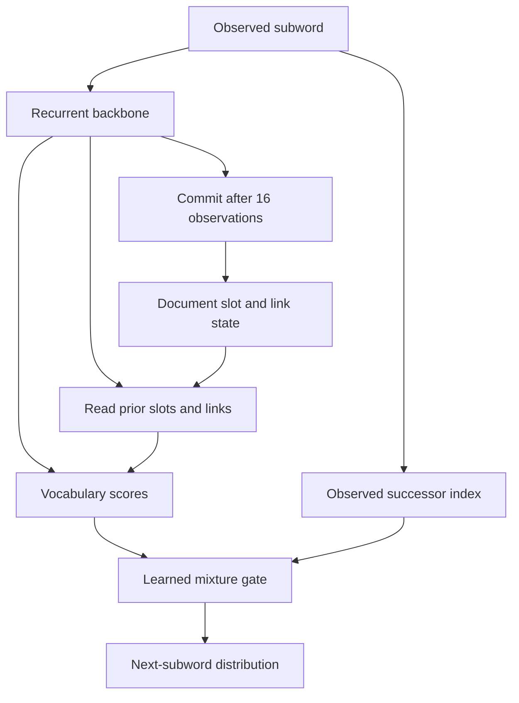

# COG-LM-001

This directory contains an attention-free autoregressive text model, its CPU training and inference entry points, and the comparisons defining the first COG language-model cycle. The vocabulary is a 2,048-ID reversible byte-level BPE trained on the WikiText-2 training articles. ID 0 is the document terminator. The 30M COG configuration has six 640-wide blocks, 8 working slots, 32 channels per slot, and at most 256 observed successor records per document.

## How the model computes

A token enters a residual block with a learned diagonal recurrence. Each channel computes a bounded retention rate and candidate value, combines that value with its previous state, and passes the result through a feed-forward network. The batch scan and one-token streaming recurrence calculate the same quantity within floating-point tolerance. No token-to-token self-attention is used in COG. A learned read over eight slots and their link matrix contributes to the vocabulary projection. The model commits convex rewrites after each block of 16 observed tokens. The current block can only read previously committed rows. A separate gate mixes the vocabulary prediction with a bounded, exact last-successor lookup keyed by two input tokens. The observed successor becomes writable only after it arrives. Each new document starts with empty state.




The working rows and links adapt the CSM record/update idea and the LRC bounded read idea. The successor table adapts COG-099's observation/action transition memory to token prediction. This language experiment trains a new model from scratch. The earlier COG controller, native CSM executor, LRC learned routing policy and Veritas action verifier are outside the model. Only generated text is returned.

The controls include a RoPE Transformer with a real KV cache and the actual reference Mamba-2 mixer. The Mamba arm uses the same surrounding embedding, residual LayerNorm and tied vocabulary projection used here. Its scan is the portable PyTorch implementation, with 8 state channels, trained from scratch. Hardware-optimized Mamba kernels were not benchmarked. The local COG control trains the same recurrent backbone with both extra memories absent.

## Generate with the released model

Unzip the model package, change into its directory and launch the following command. The loader uses CPU PyTorch 2.10.0, einops 0.8.1 and tokenizers 0.22.1.

```bash
python infer.py --weights model.pt --tokenizer tokenizer.json --prompt "The history of the city" --tokens 48 --seed 31 --save-state session.pt
python infer.py --weights model.pt --tokenizer tokenizer.json --resume-state session.pt --tokens 32
```

The saved session carries all recurrent, slot, link, partial-block, successor and sampling state required to resume at the same temperature. Use a new prompt for a new document. The model archive binds the original checkpoint to its exact tokenizer. Model and tokenizer digests also guard session restoration. This is a base text completer trained with next-token prediction. There is no chat instruction tuning.

## Reproduce the experiment

Use Python 3.12 on Linux, install the CPU wheel of PyTorch and the pinned requirements. The source data are public. The WikiText-2 raw Parquet files come from revision b08601e04326c79dfdd32d625aee71d232d685c3 of Salesforce/wikitext, under wikitext-2-raw-v1. Store the three files as train.parquet, validation.parquet and test.parquet in the raw directory. For transfer, use data/MultiWOZ_2.2/test/dialogues_001.json at revision fe0c8e65cfcd8462bd33c86e35f21addc84ca82b of budzianowski/multiwoz. For LAMBADA use en/test/en.parquet at revision 900124bf3b8235c6daf21033af9948b3f07346c4 of EleutherAI/lambada_openai. Exact source and token hashes are recorded in evidence/data_manifest.json and discourse.py.

```bash
python data.py --raw /data/raw --dialogue /data/dialogues_001.json --out /data/prepared --tokenizer tokenizer.json
cmp /data/prepared/data_manifest.json evidence/data_manifest.json
python -m pytest -q test_lm.py
python train.py --arm cog --scale scale --seed 17 --data /data/prepared --out /data/fits
python train.py --arm cog --scale scale --seed 17 --resume /data/fits/scale-cog-17.pt --data /data/prepared --out /data/fits
python evaluate.py --weights /data/fits/scale-cog-17-continued.pt --data /data/prepared --out /data/scores
python discourse.py --weights /data/fits/scale-cog-17-continued.pt --data /data/prepared --out /data/scores --parquet /data/en.parquet
python long_context.py --weights /data/fits/scale-cog-17-continued.pt --data /data/prepared --out /data/scores
python probes.py --weights /data/fits/scale-cog-17-continued.pt --data /data/prepared --out /data/scores
python benchmark.py --weights /data/fits/scale-cog-17-continued.pt --data /data/prepared --out /data/scores
```

Train compact arms cog, local, transformer, mamba2, slots and episode with seeds 17, 29, 43. Train the short scale arms cog, local, transformer and mamba2 with seed 17. Continue the large cog and local arms from their final short-run weights. Continuation restarts AdamW and draws fresh training windows under a fixed seed and schedule. Evaluate every checkpoint. Run the secondary probes for seed 17 of the four core arms at both sizes, plus the two continuations. Benchmark the four short scale arms and both continuations sequentially. Finally run summarize.py and replay.py with the recorded fits, raw score directory, data and output paths.

The unit of analysis in the primary uncertainty intervals is the held-out article. Repeated model seeds share those articles. All formal comparisons use matched target exposure within their panel. Wall times and throughput refer to this CPU reference and the actual measured work. See REPORT.md for the results and boundaries.

## Sources

- [Original COG-ATTN-099](https://github.com/FPC-effortless/cdl-attention-experiment/pull/84)
- [Woyengi LRC implementation](https://github.com/FPC-effortless/cdl-attention-experiment/blob/b50e1615e16410b06af34081e83762460c0f9de3/relational_composition/model.py)
- [Woyengi CSM reference](https://github.com/FPC-effortless/cdl-attention-experiment/blob/6afd3566ea6dabb2376e6ae0f2d5537007504848/research/csm_parallel_022/reference019.py)
- [Mamba-2 paper](https://proceedings.mlr.press/v235/dao24a.html)
- [Mamba-2 minimal by Tommy Ip](https://github.com/tommyip/mamba2-minimal/tree/4f4413731f24303b4e046962bce6ca5b6a3b13d6). The unmodified source and Apache-2.0 license are in vendor/.
- [RWKV-7 paper](https://arxiv.org/abs/2503.14456)
- [Gated Delta Networks paper](https://arxiv.org/abs/2412.06464)
- [WikiText](https://huggingface.co/datasets/Salesforce/wikitext), [MultiWOZ](https://github.com/budzianowski/multiwoz) and [LAMBADA](https://aclanthology.org/P16-1144/)
