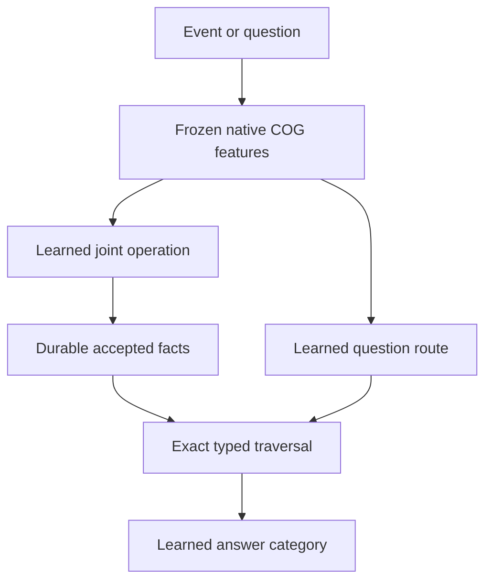

# Learned factual archive: connected, but not qualified on fresh wording

**The archive is now connected to an actual trained COG-based factual mode.
The learned memory path fails the prospectively fixed unfamiliar-history gate.**
Every control and candidate run achieved perfect canonical TRAIN, DEV, and
familiar TEST histories. Every run scored **0/256 complete fresh TEST pairs**.
The candidate therefore stays experimental. It is not a writer repair ready for
unrestricted automatic factual memory.

This report covers the frozen native model plus newly trained factual adapter.
The separate storage/retrieval and decoder-serving improvements have their own
reports. No PULSE checkpoint, old ANT TEST panel, oracle writer, or callback answer
was used as a substitute for this model-level experiment.

## What was built

The admitted backbone is the real `COG_CONNECTED_1M.pt`, seed 33/update 4096,
SHA256 `d8bab3d1d99a43dfb6cca2257f2caae4d3a7282d62b079c92874ce736a44ec3c`.
It has 993,574 parameters and a 65-character tokenizer. The loader verifies the
checkpoint digest, the three native model-source digests embedded in that
checkpoint, strict state compatibility, and the native parameter count.

The entire trained native language model remains present and frozen. A factual
adapter reads the actual post-board native character features, using all six
native blocks and the connected native record/controller board. It adds a
32-dimensional GRU, a joint 97-way operation head, an eight-way question route,
and a learned 13-to-nine answer decoder. Total size is **1,012,141 parameters**,
including **18,567 trainable factual parameters**.



Record typing, storage, and link traversal are exact infrastructure. The model
learns which operation to propose, which record the question asks for, and which
answer label to emit from the typed read result. Its inference API takes text;
gold operations, routes, ledger states, and answers are evaluator-only data.

The bounded schema has eight owner names, four boxes, four items, four
owner-of-box records, and four item-to-box records. A box question reads one
record; an item question reads the selected item link and its owner record.
Unknown is a separate category. Invalid record/value proposals are rejected and
scored wrong on required writes. They are never projected to the gold action.

Archive facts affect the learned categorical answer head. The original text
continuation head remains unchanged and does not consume the factual archive.
Native transient state starts fresh for each bounded event/query. This study
does not qualify pronouns, an open entity vocabulary, action/time binding,
arbitrary conversation facts, or lifetime-scale histories.

## Fixed experiment

The data and protocol were locked before calibration or fitting. Semantic roots
are split into 512 TRAIN families, 128 DEV, 256 familiar TEST, and 256 fresh TEST.
Each family has two histories of length 8, 24, or 64. One transfer is completed in
one world and cancelled in the other, so the correct final answers differ.
Histories include overwritten facts, distractor roles, cancelled actions, and
later unrelated writes that can damage facts previously stored correctly.

The control receives canonical TRAIN wording. The candidate receives three
matched views of the same semantic roots, including recipient/completion forms
and globally consistent within-type role/value permutations. Four fresh syntax
families are absent from TRAIN and DEV. The native language pretraining is not
claimed to exclude the English words used in those templates.

Both recipes used head seeds 17, 29, and 41, identical initial heads within each
matched seed, Adam with learning rate 0.003, and **2,048 updates per run**. Every
update samples 96 event positions and 32 queries. A discarded TRAIN-only timing
calibration retained the full prospective update cap. No checkpoint selection,
early stopping, extra fit, or revised threshold followed the results.

The budget is matched optimizer updates and sampled examples, not equal
characters or equal CPU time. The candidate's longer descriptions cost more
training CPU. The primary TRAIN score is exhaustive on all 512 canonical
families, not a sampled accuracy estimate.

## Primary outcome

A strict pair requires **every predicted operation**, **every post-event
ledger**, and **both final answers** to be correct across both histories.
Operation identity and ledger equality are recorded separately: a wrong but
idempotent operation cannot disappear inside a correct ledger score.

| Arm | Seed | Canonical TRAIN | Familiar DEV | Familiar TEST | Fresh TEST |
| --- | ---: | ---: | ---: | ---: | ---: |
| Control | 17 | 512/512 | 128/128 | 256/256 | 0/256 |
| Candidate | 17 | 512/512 | 128/128 | 256/256 | 0/256 |
| Control | 29 | 512/512 | 128/128 | 256/256 | 0/256 |
| Candidate | 29 | 512/512 | 128/128 | 256/256 | 0/256 |
| Control | 41 | 512/512 | 128/128 | 256/256 | 0/256 |
| Candidate | 41 | 512/512 | 128/128 | 256/256 | 0/256 |

All six runs pass the pinned canonical competence gate. The candidate loses
zero control-correct familiar TEST pairs. All six fail the fresh gate, at all
tested history lengths and in all four held-out wording families. Complete final
ledgers also score zero in every fresh run.

The fresh component scores expose improvement that the complete-history gate
correctly refuses to promote into a repaired-memory claim:

| Arm | Seed | Exact event operations | Both required chains | Both question routes | Both answers |
| --- | ---: | ---: | ---: | ---: | ---: |
| Control | 17 | 21.62% | 0/256 | 136/256 | 0/256 |
| Candidate | 17 | 28.06% | 9/256 | 232/256 | 9/256 |
| Control | 29 | 20.50% | 0/256 | 152/256 | 0/256 |
| Candidate | 29 | 19.26% | 0/256 | 192/256 | 0/256 |
| Control | 41 | 25.05% | 0/256 | 80/256 | 0/256 |
| Candidate | 41 | 28.31% | 2/256 | 160/256 | 0/256 |

Each fresh panel has 16,336 event positions. Required-chain correctness is an
independent post-fit diagnostic using the gold required chain only inside its
scorer; it is not given to the model. Three seeds reuse the same test families
and one frozen backbone, so they are initialization replications rather than
three independent pretrained models or populations. `RESULTS.json` reports
per-panel Wilson intervals; no pooled lifetime reliability claim is made.

## What still breaks

The candidate reduces missed writes but often substitutes a different wrong
write. In seed 17, missed writes fall from 11,695 to 5,573, while joint
address/value errors increase from 526 to 3,050. Damage to already-correct,
unchanged facts rises from 108 to 698 events. Seeds 29 and 41 show the same broad
tradeoff. Every predicted fresh operation is schema-valid; validity does not
establish factual truth.

Question routing also remains a learned failure point. Seed 17 gets all routes
right in three fresh grammar families but only 40/64 in passive-delivery wording.
Seed 41 has two pairs with correct required chains yet no pairs with both answers
right. A sound archive cannot compensate for the model asking the wrong record.
The root's independent accepted-fact intervention panel isolates this query
failure without requiring the writer to construct the ledger.

An additional frozen-prediction diagnostic checks the candidate's own exposed
TRAIN views. Seeds 17 and 41 are correct on all 1,536 pairs across the three
trained views, yet remain zero on complete fresh histories. Seed 29 is correct
on canonical 512/512, recipient 388/512, and completion 452/512. That seed also
underfits its augmented training histories. These diagnostics neither alter the
fixed canonical DEV gate nor redefine the primary TEST endpoint.

Zero native features, shuffled native features, empty archives, and shifted
archive values all produce zero strict familiar TEST pairs in every run. Those
controls confirm dependence on information in this path. They do not establish
that this pretrained backbone is superior to a matched randomly initialized
backbone or another model; that comparison was not run.

The independent replay reconciled all **6,912 primary pair rows** exactly,
including operations, post-event ledgers, final ledgers, answers, routes, invalid
writes, first errors, and damage. It added no model calls, oracle correction,
training, or selection. See `../review/DIAGNOSTICS.md`.

## Durable inference and provenance

`FactualMemory.observe` automatically stores the raw observation and a model-
identified decision receipt. An explicit host policy accepts a valid predicted
write. That authority records permission, not verified truth. The decision's
`status="written"` classifies a valid proposed operation; a pending receipt is
not an acceptance acknowledgement. A successful `WriteResult` is returned only
after `accept` commits. Retrying the same request completes the same proposal or
returns its historical acceptance; it does not silently rebase an old event.

All eight possible target revisions are captured before writer inference, and
the chosen record's original revision is used at acceptance. This rejects a
concurrent update after its snapshot. It does not promise a global event-time
ordering across simultaneous chats.

`FactualMemory.ask` routes from the question's native features, reads only the
selected record/link dependencies, and persists a reply only after the store
atomically revalidates every read revision and live source. Revision zero and
deleted-row revisions are tracked, so insertion or recreation cannot turn a
stale unknown into an accepted answer. Exact-request replay is a historical
receipt; a new request sees later corrections. Relevance by the intended meaning
still requires correct learned routing: invariance of an actual read set alone
does not prove semantic relevance was understood.

Model identity binds the entire native and adapter state, ontology, tokenizer,
configuration, flags, and admitted source/checkpoint metadata. Checks before and
after new inference, and before replay, reject changed weights, training mode,
and local/global forward hooks. Trusted host code and loader remain the boundary;
this is not a sandbox against arbitrary runtime code replacement.

Nineteen focused infrastructure tests passed, covering invalid proposals, retry
authority, pending decisions, concurrent write revisions, relevant/irrelevant
answer races, absent/recreated facts, source erasure, hooks, and model mutation.
These unit tests use fixture predictions and are not learned-performance evidence.

The prespecified actual-model serving sample uses candidate 17 and the first
four familiar/fresh families at lengths 8 and 64, without selecting successes.
It executed **1,152 native event predictions through the durable interface and
32 answers**. Raw native inference, cached evaluation predictions, and durable
state/results matched exactly on all 16 pairs. All eight familiar pairs were
strict-correct; all eight fresh pairs failed. Each history reopens its database
and uses a new chat for the question. The separate root integration tests supply
fresh-process restart and real-model concurrency evidence.

## Cost, including work outside fitting

One CPU thread was used. The durable sample uses workspace overlay storage,
explicitly not the default `/tmp` tmpfs. The environment is Python 3.12.14 and
PyTorch 2.10.0+cpu; `DURABLE_RESULTS.json` records `TMPDIR` and `findmnt` output.

| Measured phase | CPU seconds | Wall seconds |
| --- | ---: | ---: |
| TRAIN feature extraction and discarded calibration, with loading/I/O | 8.579 | 8.631 |
| Six complete fit phases, with loading/checkpoint I/O | 224.171 | 224.870 |
| Fixed evaluation, including remaining feature extraction/I/O | 16.870 | 16.953 |
| Frozen prediction export and cache-integrity checks | 5.547 | 5.562 |
| Actual durable inference/parity sample | 44.346 | 48.091 |
| Sum of those measured phases | **299.514** | **304.105** |

Scored optimizer updates alone cost 223.0075 CPU seconds, below the 600-second
cap. Native feature extraction across both cache phases cost 15.3253 CPU seconds,
below its 900-second cap. It processed 4,880 unique event/query strings and
228,207 characters; fitting reused cached float32 native features. Deployed
inference computes native features, rather than using that evaluation cache.

The phase totals include model loading, validation, cache/checkpoint I/O, and
durable I/O performed inside those phases. They exclude Python process startup
and imports, initial dataset generation, and the root's separate validation,
diagnostic, and test suites. The original data-generation command took 6.681
tool-reported wall seconds; its CPU time was not instrumented. Therefore the
table is a measured phase total, not a claim of fully instrumented total project
compute. The separate augmented-TRAIN replay has its own timing in its JSON.

| Familiar history length | Raw event mean | Durable event mean | Raw answer mean | Durable answer mean |
| --- | ---: | ---: | ---: | ---: |
| 8 events | 9.07 ms | 22.08 ms | 6.72 ms | 17.49 ms |
| 64 events | 9.03 ms | 22.67 ms | 8.23 ms | 19.01 ms |

These comparisons use exactly matched outputs and correctness. The extra cost
includes full identity checks, source/decision/proposal/acceptance persistence,
revision snapshots, dependency validation, and reply persistence. It is not
isolated SQLite latency. The raw-then-durable order is fixed, the answer sample is
small, and this is one container environment. Fresh wording has larger latency
and failed correctness; it cannot support an efficiency claim. The architecture
is **not described as faster or generally efficient** on this evidence.

## Evidence and reproducibility

The original data/protocol lock remains intact. `DATA_MANIFEST.json` preserves
the initial implementation hash; `LOCK.json` freezes the subsequently reviewed
implementation used for calibration, all fits, and evaluation. Two independently
reproduced runtime fixes before that freeze reject global hooks and preserve
pre-inference write revisions. The reviewer verified the original/fixed source
digests rather than silently attributing fixed behavior to the earlier source.

Public evidence in this directory includes `PROTOCOL.md`, `DATA_MANIFEST.json`,
`LOCK.json`, `CALIBRATION.json`, `FITS.json`, `RESULTS.json`, `TRACE_EXPORT.json`,
`AUGMENTED_TRAIN_DIAGNOSTIC.json`, `DURABLE_PROTOCOL.json`, and
`DURABLE_RESULTS.json`. Complete native/fitted weights, generated histories,
features, and per-text/per-pair traces stay with the private artifact bundle.
All six full fitted checkpoints preserve every native tensor exactly; the strict
loader verifies that again on reload. The root's independent native-language
validation also checks unchanged logits and recurrent states.

Example reproduction commands in a separate checkout, with admitted native kit,
new private artifact directory, and workspace temporary directory supplied in
the exported `KIT_DIR`, `ARTIFACT_DIR`, and `WORKSPACE_TMP` variables. Run from
this `learned/` directory:

```bash
python - <<'PY'
import os
from pathlib import Path
import runner  # Adds the repository's NanoCOG package to the import path.
from dataset import pin
pin(Path(os.environ["ARTIFACT_DIR"]))
PY
python runner.py calibrate --kit "$KIT_DIR" --private "$ARTIFACT_DIR"
python runner.py fit --kit "$KIT_DIR" --private "$ARTIFACT_DIR"
python runner.py evaluate --kit "$KIT_DIR" --private "$ARTIFACT_DIR"
python trace_export.py --kit "$KIT_DIR" --private "$ARTIFACT_DIR"
TMPDIR="$WORKSPACE_TMP" python durable_check.py --kit "$KIT_DIR" --private "$ARTIFACT_DIR"
```

Existing calibrated artifacts intentionally reject a second calibration. Use a
new artifact directory containing a regenerated corpus with the pinned hash to
reproduce the full experiment. The loader admits the prescribed checkpoint and
source, not an arbitrary file with the same model name.

**Decision:** retain the guarded archive integration and its tests, preserve the
negative result, and keep learned factual mode experimental. Any next writer
design needs a new prospectively locked fresh panel; these four TEST grammar
families are now exposed diagnostics. Better internal head scores or fewer
missed writes do not satisfy the complete-history requirement.
